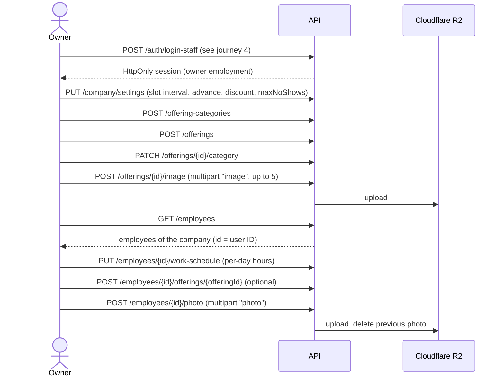
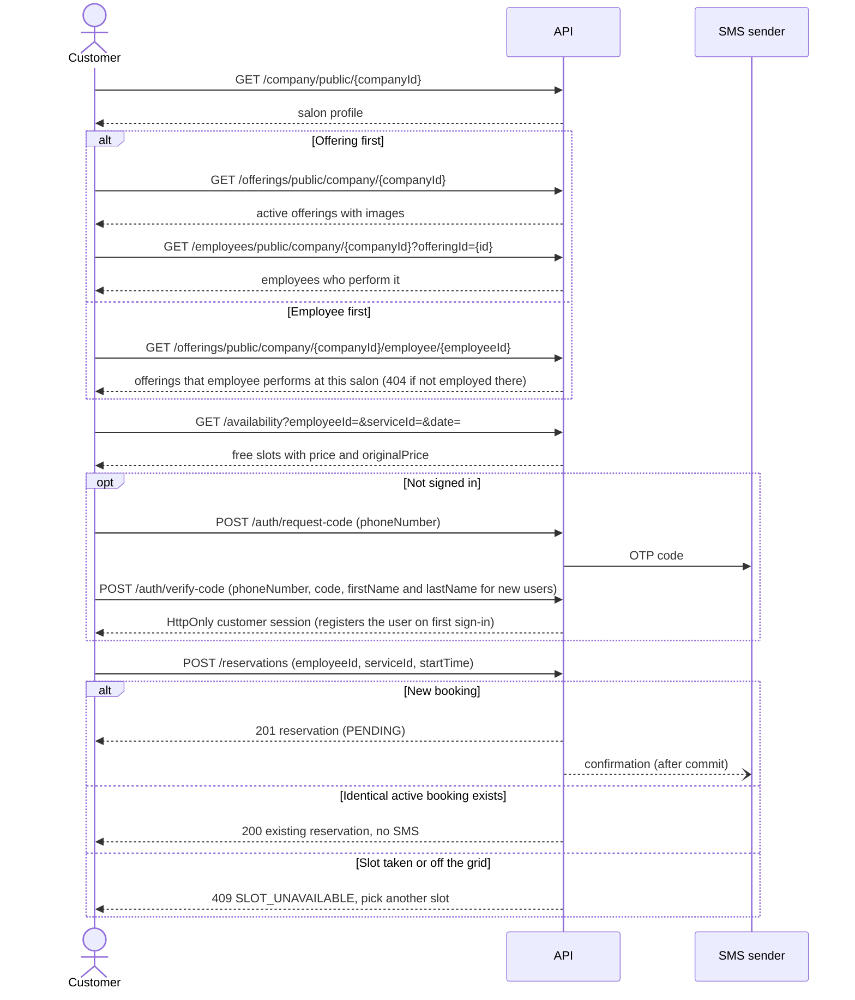
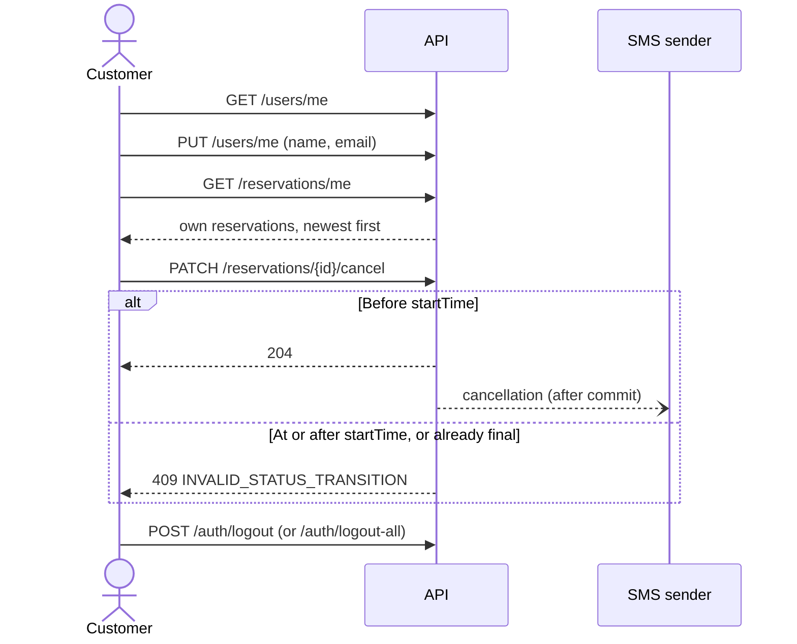
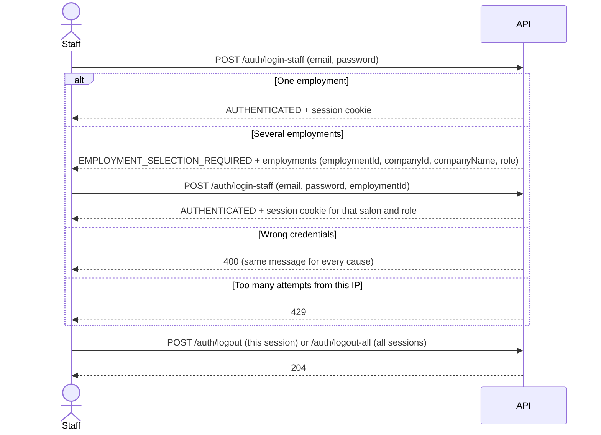
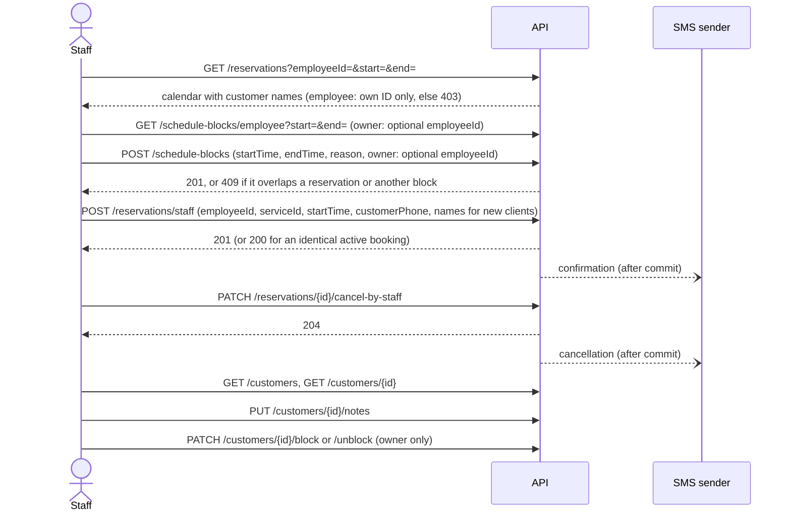
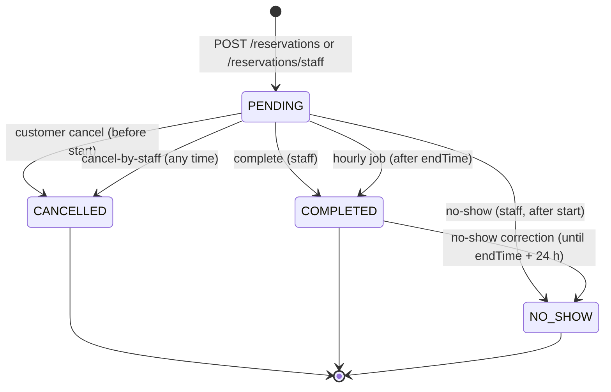
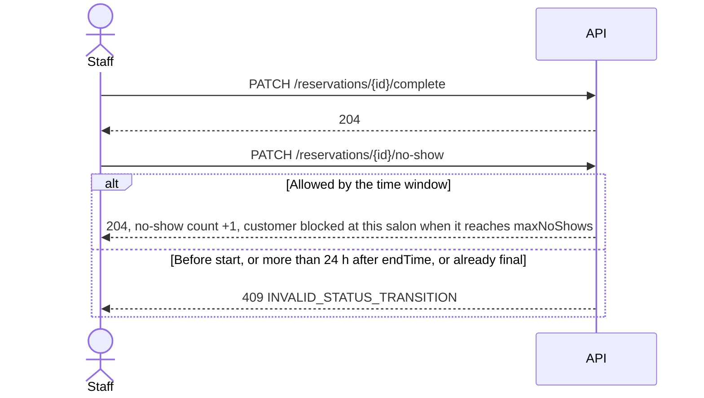
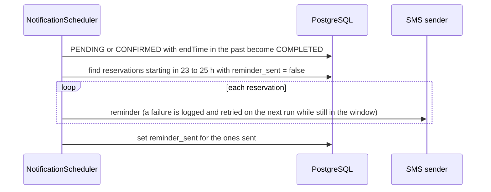

# User flows

End-to-end journeys through the API, per actor. Each journey shows the order of calls; the rules behind each step live in the linked docs and are not repeated here. Paths are relative to `/api`. Public reads need no authentication; all API calls use credentials/cookies, and unsafe calls also send `X-XSRF-TOKEN` obtained from `/auth/csrf`. Refresh CSRF after login/logout; see [the frontend contract](./architecture.md#csrf-cookies-and-frontend-contract).

| Actor | Signs in with | Journeys |
| ----- | ------------- | -------- |
| Owner | Email and password | [Salon setup](#1-salon-setup-owner), [staff sign-in](#4-staff-sign-in), [day-to-day](#5-staff-day-to-day), [visit outcome](#6-visit-outcome) |
| Employee | Email and password | [Staff sign-in](#4-staff-sign-in), [day-to-day](#5-staff-day-to-day), [visit outcome](#6-visit-outcome) |
| Customer | SMS code | [Booking](#2-customer-booking), [self-service](#3-customer-self-service) |
| System | — | [Background jobs](#7-background-jobs) |

## 1. Salon setup (owner)

Companies and staff accounts are not created through the API; they come from the database (locally, the `dev` seed in `DataInitializer`, see [development](./development.md)). From there the owner configures the salon. Until an employee has a work schedule, availability returns no slots for them and customer bookings are rejected.

Rules: [company settings](./availability.md#company-settings-that-affect-booking), [work schedules](./availability.md#work-schedules), [offering assignments](./availability.md#offering-assignments), [file storage](./architecture.md#file-storage-cloudflare-r2).

## 2. Customer booking

The customer browses anonymously and signs in only to book. There are two ways in; both end in the same slot pick, sign-in, and booking.

- **Offering first:** pick an offering, then an employee who performs it.
- **Employee first:** start from a known employee and list what they perform at this salon. There is no public endpoint listing all employees of a salon; the employee ID comes from the client (for example a link to the employee's page) or from an earlier offering-first listing.

Rules: [slot calculation](./availability.md#slot-calculation), [public endpoints](./availability.md#public-booking-endpoints), [booking rules](./reservations.md#booking-rules), [retries](./reservations.md#retries-and-idempotency), [rate limits](./architecture.md#rate-limiting-redis).

## 3. Customer self-service

Rules: [lifecycle](./reservations.md#lifecycle), [sessions](./architecture.md#sessions-and-logout).

## 4. Staff sign-in

A staff member can work at several salons. Each session is scoped to one employment. Switching salons requires CSRF-protected logout, CSRF refresh, then signing in again with another `employmentId`.

Rules: [authentication](./architecture.md#authentication), [login hardening](./architecture.md#secret-and-login-hardening).

## 5. Staff day-to-day

Everything is scoped to the salon in the session principal. An employee sees and blocks only their own time; an owner can act for any employee of the salon.

Staff bookings skip the advance-time and slot-grid checks but not the overlap check. Rules: [booking rules](./reservations.md#booking-rules), [schedule blocks](./availability.md#schedule-blocks), [customer blocking](./architecture.md#customer-blocking-and-no-shows), [reading reservations](./reservations.md#reading-reservations).

## 6. Visit outcome

After the visit, staff record what happened, or the hourly job completes it. A completed visit can still be corrected to no-show for 24 hours after it ends.

`CONFIRMED` is never set and behaves like `PENDING`. An owner can also hard-delete a reservation (`DELETE /reservations/{id}`).

Rules: [lifecycle and transitions](./reservations.md#lifecycle), [customer blocking](./architecture.md#customer-blocking-and-no-shows), [ADR-0010](./adr/0010-cancellation-window-and-no-show-correction.md).

## 7. Background jobs

Both jobs run every hour on the hour in the business time zone, on a single instance.

Rules: [notifications and jobs](./architecture.md#notifications-and-scheduled-jobs), [time handling](./time-handling.md). SMS is currently written to the log only; see the known gap there.
